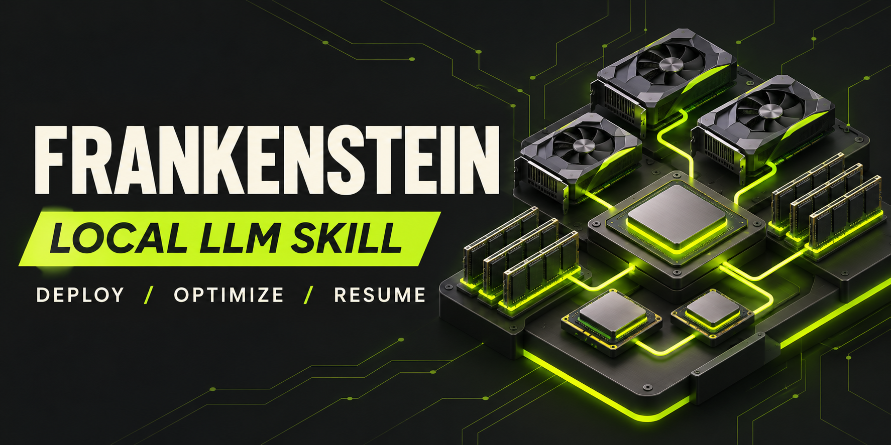
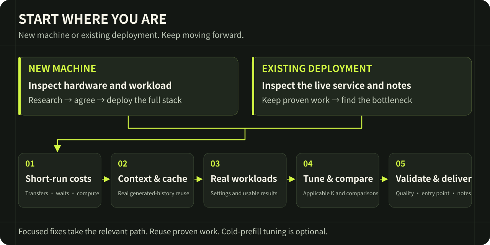

# Frankenstein · Local LLM Deployment & Optimization Skill

**Stitch together proven inference components. Adapt what is necessary. Verify the complete deployment.**

English | [简体中文](README.zh-CN.md)

Frankenstein is an Agent Skill centered on composing existing inference implementations across repositories. Combinations such as **Strata + 1Cat + Basalt + Radiance** express its core approach: select useful parts, connect their interfaces and dependencies, and adapt them to the target hardware and model. Find out which path is fast and why, inspect the source, then reuse the code or port its performance mechanism to the target device. Missing V100 support calls for a concrete SM70 implementation plan, not automatic rejection. Write the adaptations needed to preserve that mechanism while avoiding unrelated reinvention.

The workflow connects hardware-aware deployment and optimization to actual runtime behavior: compute, transfers, waiting, prefix reuse, memory budgets, and real-task results. The repositories in a combination depend on the workload; the named combination is not a universal recipe or a performance claim.

This repository contains instructions, engineering case studies, and small test fixtures. It does not include an inference engine or model weights. The execution guides are currently in Chinese; this English page introduces the workflow.

## What you can use it for

| Starting point | What the agent does |
|---|---|
| A new machine | Inspect hardware, research compatible options, propose a deployment, and implement the agreed configuration |
| An existing deployment | Preserve the working setup, inspect what is actually running, identify bottlenecks, and build on verified improvements |
| One specific problem | Diagnose slow responses, decode performance, cache loss, transfer stalls, or a backend issue without restarting the entire workflow |
| A long optimization project | Resume from deployment notes and live process state, reusing completed work |
| A backend port | Reuse compatible runtime and operator implementations, bridge the missing interfaces, and develop only the remaining required pieces |

The workflow covers local and SSH hosts, GPU and CPU inference, multi-GPU execution, and expert-offload configurations. Compatibility is checked on the target system.

## Start here

1. Download or clone this repository.
2. Install the complete [`skills/local-llm-deployment-speedup`](skills/local-llm-deployment-speedup) folder into your agent's supported skill directory. Keep its references, assets, and metadata together. Alternatively, ask the agent to read its [`SKILL.md`](skills/local-llm-deployment-speedup/SKILL.md) directly.
3. Give the agent access to the target terminal or SSH host, plus your model and usage requirements. It must be able to inspect files and code and perform the work you authorize.

**For a new deployment:**

> Use local-llm-deployment-speedup to inspect this machine and recommend a local model deployment for [my workload]. Explain the model, precision, memory budget, backend, and tradeoffs. Once we agree on the plan, deploy it, optimize it, and verify the actual application entry point.

**For a model you already run:**

> Use local-llm-deployment-speedup to continue optimizing my existing deployment at [path or host]. Read its deployment notes and inspect the active service first. Preserve accepted improvements and my configuration. Diagnose [slow decode / response latency / cache loss], implement relevant fixes, and verify the affected behavior.

## How optimization progresses

**Inspect → research → agree on a plan → deploy the full configuration → optimize short-request execution → validate longer context and cache reuse → run your actual tasks → tune applicable speculative depth → compare final results → verify quality.**

Cold-prefill optimization is a separate, optional performance phase. Required prefill implementation and correctness fixes are part of deployment. Existing deployments reuse valid stage results; focused repairs do not require the whole sequence.

The agent checks complete execution costs, including transfers, synchronization, expert supply, and state updates. Prefix KV/hybrid-state reuse and GPU expert caching are measured separately. Actual generated-history continuation is tested, not just repeated identical prompts.

## Engineering cases

The author began refining this Skill in September 2026, drawing on hands-on local model deployment work. These are historical results from particular configurations, not speed guarantees for other systems.

| Case | Reported result | Scope |
|---|---|---|
| 4× V100, Pi 27B NVFP4 + DSpine K7 | About **522 tokens/s** peak single-request decode; a separate follow-up measured about **523 tokens/s** | Short Python tasks, temperature 0, thinking off; excludes prefill and first-token latency |
| Dual 2080 Ti, IQ3 optimization path | Later Python measurements around **21–22 ms/round**, short best around **18 ms**, throughput peak **220+ tokens/s** | Different stages and workloads are documented separately; this is not one controlled before/after comparison |

- [V100: research, DSpine integration, runtime optimization, and cache repair](skills/local-llm-deployment-speedup/references/case-v100-pi-dspine.md)
- [Dual 2080 Ti: expert supply, kernels, pipeline, and state management](skills/local-llm-deployment-speedup/references/case-swift-iq3xxs-python.md)
- [Cache failures and fixes](skills/local-llm-deployment-speedup/references/cache-failure-cases.md) and [long-reasoning prefix/KV-state diagnosis](skills/local-llm-deployment-speedup/references/reasoning-prefix-cache.md) — token round trips, tools, images, hybrid checkpoints, dependency lifetimes, and eviction (Chinese).
- [Long-context attention: implementation workflow and five source-level repository cases](skills/local-llm-deployment-speedup/references/long-attention-optimization.md) — split-KV, reduction, KV layout, dispatch, CUDA Graphs, and runtime verification (Chinese).
- [Cross-repository composition](skills/local-llm-deployment-speedup/references/cross-repository-composition.md) — combine a host runtime with useful kernels, collectives, or vision components from other engines and models; distinguish direct ports, adapted mechanisms, and operator fusion (Chinese).
- [GitHub source comparison](skills/local-llm-deployment-speedup/references/github-runtime-comparison.md) — connect runtime bottlenecks to pinned code, dispatch conditions, local patches, and incremental implementation decisions (Chinese).
- [Millisecond optimization lessons](skills/local-llm-deployment-speedup/references/millisecond-case-lessons.md) — request-path fallbacks, host preparation, tiny blocking transfers, shape coverage, exact fusion, buffer ownership, profiler effects, and rejected candidates (Chinese).
- [Implementation methods organized by bottleneck](skills/local-llm-deployment-speedup/references/optimization-engineering.md)

Private runtime logs are not included. The cases explain conditions, measurements, and limitations; this repository is not a publicly reproducible benchmark suite. The V100 short-test case reports syntax checks rather than executed-function correctness, and does not establish full application acceptance.

## What a completed deployment includes

- The real application/API entry point and start, stop, and reuse instructions.
- The configuration and build actually loaded by the service.
- Performance observations with timing boundaries and cache conditions.
- Results from your chosen tasks, plus failures, untested items, and limitations.
- A deployment note that lets another agent continue without duplicating work.

The guides distinguish observed behavior from unavailable internal metrics. An inaccessible counter stays unverified; it does not become an invented cache hit or prevent unrelated useful work.

## Your real acceptance task

Fill in the [task section at the end of the skill](skills/local-llm-deployment-speedup/SKILL.md#操作者填写真实测试任务): the actual request, input materials, required deliverables, and quality requirements that must not regress. Keep the filled version in your deployment notes. The agent preserves a comparable baseline and checks the final configuration against the same task and criteria; speed cannot compensate for failed requirements.

## Feedback

For a useful issue, include hardware, model and quantization, backend version, workload, timing definition, cache conditions, and the observed result. Use public or redacted examples. Reports from additional hardware and execution agents are especially valuable.

Choose research-only updates or [authorized autonomous research and optimization](skills/local-llm-deployment-speedup/references/autonomous-optimization.md). In autonomous mode, the agent resumes deployment notes, selects candidates, implements and validates changes, and records what to do next without asking again for actions already authorized. Scheduling requires a separate explicit request; installing or updating this skill starts neither a scheduled task nor an optimization run.

## License

[MIT](LICENSE). Models, runtimes, and third-party code retain their own licenses.
