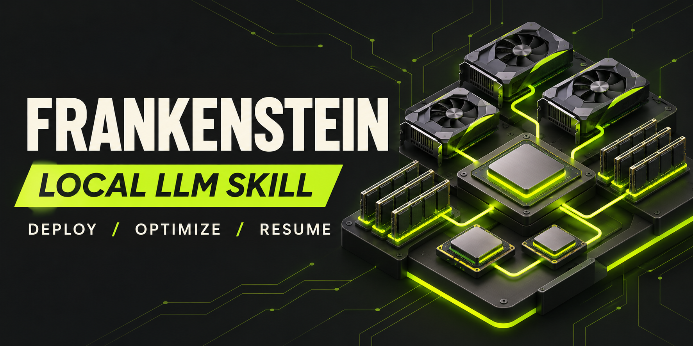
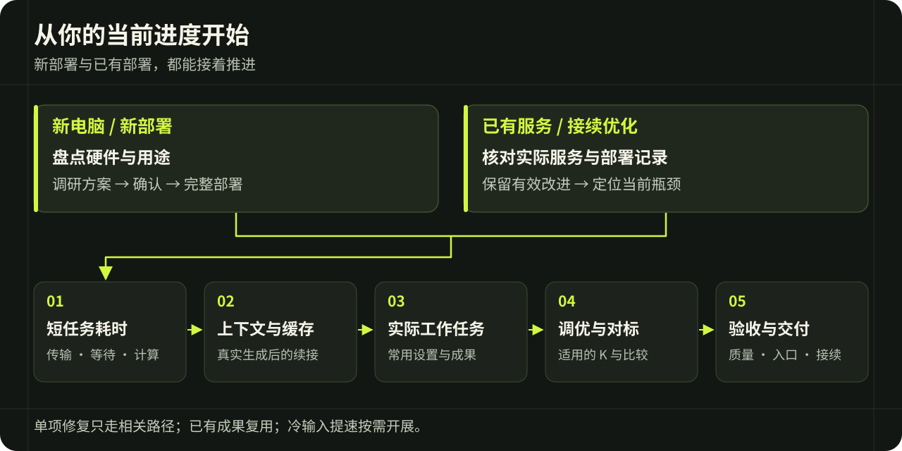

# Frankenstein · 本地模型部署与持续优化

[English](README.md) | 简体中文

让有后端工程能力的AI，根据真实硬件与原始案例从零部署本地模型，或在已有部署上继续优化速度、缓存和实际任务表现。本项目提供Agent Skill指南，不附推理引擎、模型权重或账号凭据。

作者从**2026年9月开始持续打磨这套Skill**，将本地模型部署实践中的测试、修复和优化经验逐步沉淀进技能。当前作者实测成果包括：

- **4卡V100运行27B＋DSpine K7：** 温度0、关闭思考，单请求解码速度首轮峰值约522 tok/s；后续整轮补测约523 tok/s、13.57～13.77ms/轮。
- **双2080Ti的IQ3优化路径：** 从早期约50ms/轮的功能部署，推进到后期Python常态21～22ms/轮、短时最低约18ms/轮、吞吐峰值220+ tok/s。

成果背后的方法包括完整部署、传输与等待排查、专家供给、硬件算子适配、流水线和状态管理。峰值与常态分列，详细过程见[Python主案例](skills/local-llm-deployment-speedup/references/case-swift-iq3xxs-python.md)和[经验案例](skills/local-llm-deployment-speedup/references/experience-cases.md)。

V100路线由作者通过**ChatGPT定时调研发现1cat更新和新草稿，再使用Codex实施适配与优化**。[V100完整案例](skills/local-llm-deployment-speedup/references/case-v100-pi-dspine.md)记录Pi投影融合、DSpine接入、K7/K8对照与缓存修复，并给出522短测的任务、token数和计时口径。

作者推荐执行AI：**GPT6 ASTRA / KIMI K3.1 PRO / FABLE5**。这些是执行技能的AI建议，不是目标机器必须部署的模型，也不是API ID或公开性能排名。

## 使用入口

让AI读取 [SKILL.md](skills/local-llm-deployment-speedup/SKILL.md)，按阶段读取相关参考。也可将整个 `skills/local-llm-deployment-speedup` 目录安装到宿主技能目录，保留 `references`、`assets`、`agents` 和 `LICENSE`，按宿主要求刷新。详见 [技能使用说明](skills/local-llm-deployment-speedup/README.md)。

示例：

> 请用这个技能盘点我的目标电脑，调研同硬件与不同硬件的部署优化案例。结合我的用途给出主模型、草稿、精度、KV池、底座内核和视觉方案，与我讨论确认后完整部署，再按技能顺序优化。我会提供实际常用任务。

已有部署可以直接这样使用：

> 请用这个技能继续优化我在【目录或主机】上的现有模型。先读部署记录并核对实际服务，保留已有有效补丁和我的配置，定位【解码慢／首响应慢／缓存丢失】的原因，完成相关改进并验证受影响部分，不重下权重、不重跑无关阶段。

## 顺序

1. 硬件盘点与使用目标。
2. 按 [六步调研](skills/local-llm-deployment-speedup/references/research-and-weekly.md) 查同/异配置、常用任务模型/量化/特别后训练、KV管理/快照/卸载、草稿及新草稿、内核与显卡专属算法，尽量整理ms；采用仓库点Star。
3. **方案确认或已有自主实施委托 → 完整部署并核实生效**，包括草稿、KV/状态池、底座/内核、视觉及适用专家缓存。需要移植后端时先按依赖研发和验证模块；模块微测不能冒充完整组合的性能测试。
4. **短任务基础ms**：温度0、零思考、视觉开启，细查全部传输/通信/等待和真实算子，必须验证短缓存续接。明确仅文本方案的视觉项不适用。
5. 短的做好才做长上下文速度与缓存；注意力主导时按[长注意力专项](skills/local-llm-deployment-speedup/references/long-attention-optimization.md)处理分块、归约、KV读取和内核分派，并参考[五个仓库实现案例](skills/local-llm-deployment-speedup/references/long-attention-cases.md)；质量问题单独记录。
6. 常用温度建议0.6、高思考、操作者指定任务；复验长思考前缀。
7. 组合确定后，在指定任务内调K，不追接受率、不宣传全局最佳K。
8. 最终与参考仓库对标，集中做正式A/B。
9. 确有需要再优化prefill；任何prefill改动不能破坏缓存。
10. 全部优化完成后，检查最终配置的真实任务质量与可用成果；不做prefill也必须完成此项。

支持[自动调研、优化与跨轮接续](skills/local-llm-deployment-speedup/references/autonomous-optimization.md)：在已有授权内自行筛选候选，连续实施、验证并写回原部署记录，不逐阶段询问是否继续；也可选择仅增量调研。频率遵从用户约定，创建定时任务需另有明确指令，更新技能不会启动任务。

[跨仓库组合](skills/local-llm-deployment-speedup/references/cross-repository-composition.md)是核心方法：保留适用底座，分别借鉴其他仓库的内核、通信、注意力、视觉和状态机制，不只选择整仓库跑分最高者。包含NInfer＋1Cat视觉、1Cat通信/计算机制、Strata量化内核与SM75适配，以及移植后无收益撤回的案例。

[GitHub源码对照](skills/local-llm-deployment-speedup/references/github-runtime-comparison.md)将当前瓶颈与固定版本代码、分派条件及本地补丁逐项比较，筛出已有、未生效、可移植或不适用的候选；自动模式在授权内接续实施。

[毫秒实测补充](skills/local-llm-deployment-speedup/references/millisecond-case-lessons.md)展开请求选项导致的回退、CPU公共准备、小回传阻塞、真实shape覆盖、融合的尺度/舍入、事件与缓冲所有权，以及profiler干扰和无收益候选处理。

前期仍做必要计时反馈和正确性检查，但不每个候选都跑统计A/B或全套长任务。混合卸载部署分别统计显存专家缓存和前缀KV/状态缓存，关注暴露传输等待与资源竞争。

缓存故障按[专项排查](skills/local-llm-deployment-speedup/references/cache-invalidation.md)和[十二组历史案例](skills/local-llm-deployment-speedup/references/cache-failure-cases.md)定位。长思考模型另有[思考内容与KV快照专项](skills/local-llm-deployment-speedup/references/reasoning-prefix-cache.md)：同时核对思考保存、原始token、KV/GDN/滑窗共同边界、依赖页与回收，避免只看重复prompt命中。

## 适用与接续

支持语言模型/视觉语言模型的本机、SSH、GPU、CPU和混合卸载场景；具体硬件、格式、算子与版本须现场核对。已有部署复用原入口及可信阶段成果。用户只要只读诊断时保持只读；主机级变更和业务中断遵从实际授权。

实际部署目录保存一份说明，记录当前阶段、已确认配置、已生效产物、短ms/传输结论、两类缓存、在途作业与下一步。运行状态、凭据和私人任务数据不写入公开技能。接续时先查原作业，避免重复启动和重下权重。

## 实践与验证

方法来自作者持续实测，也吸收了其他电脑的试用反馈。公开包包含方法、案例与测试题，私人运行日志未随包公开；案例成绩是具体配置下的实测记录，不承诺任意硬件达到同一速度。

发布前已检查文档、内部链接、测试素材，并做独立场景审查。本轮是技能文档更新，未重新运行模型性能测试；使用者按实际目标机验证部署、缓存、速度与任务质量。

## 反馈与许可

反馈请提供设备/模型/精度/底座版本、当前阶段、具体配置、计时边界、缓存口径、错误与实际结果；使用公开或脱敏材料。新的经验应写明适用条件，不能把某个K、KV大小或单卡成绩固化成通用配方。

采用 [MIT License](LICENSE)。第三方模型、runtime和代码遵循各自许可；Star不代替许可证与来源署名。
